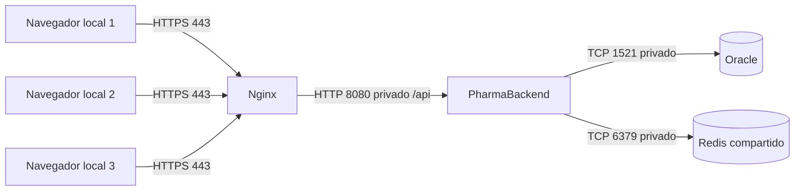

# PharmaBackend

API de PharmaSoft: Java 21, Spring Boot 4.0.7, Oracle, JWT y Redis. El frontend está en el repositorio `pharma-frontend`.

## Despliegue en producción

En la evidencia local Nginx publica `localhost:8081` (contenedor 80), Oracle `localhost:1522` (contenedor 1521) y Redis `127.0.0.1:6379`. Son puertos de laboratorio. En producción publicar solo 443 y redirigir 80 a HTTPS; API, Oracle, Redis y Actuator deben quedar en la red privada. El proxy actual expone `/api/`; consultar Actuator internamente en 8080. No exponer `/actuator/**` a Internet.

### Variables de entorno

| Variable | Propósito |
| --- | --- |
| `SPRING_PROFILES_ACTIVE` | Seleccionar `prod` y evitar el perfil de desarrollo |
| `DB_URL` | URL JDBC del servicio Oracle y su puerto |
| `DB_USERNAME`, `DB_PASSWORD` | Cuenta de mínimo privilegio y su clave, desde el gestor de secretos |
| `JWT_SECRET` | Secreto Base64 de al menos 32 bytes aleatorios, común a las réplicas |
| `JWT_EXPIRACION_MINUTOS` | Duración de sesión; valor predeterminado 30 en producción |
| `SERVER_PORT` | Puerto interno de la API; predeterminado 8080 |
| `REDIS_HOST`, `REDIS_PORT` | Dirección de la caché compartida; puerto predeterminado 6379 |
| `CACHE_TTL` | Vigencia de catálogos; predeterminado `10m`; usar `1m` solo durante la prueba |
| `FRONTEND_ORIGINS` | Orígenes HTTPS permitidos por CORS, separados por coma |
| `SPRING_DATA_REDIS_PASSWORD` | Contraseña de Redis si el servidor tiene ACL/autenticación |
| `SPRING_DATA_REDIS_SSL_ENABLED` | Habilitar TLS si Redis está en otra máquina |
| `SPRING_FLYWAY_ENABLED` | Activar migraciones después de preparar y verificar el historial del esquema |

No guardar valores reales en Git, capturas, colecciones ni el informe. `application-dev.yaml` contiene configuración local heredada: sustituirla por variables antes de compartir el repositorio. Las cuentas y claves de clase de las migraciones no son apropiadas para producción.

### Construir, desplegar y revertir

1. Identificar una versión por commit y guardar el JAR anterior junto con su configuración. Respaldar Oracle y ensayar su restauración antes de una migración.
2. Con Java 21, ejecutar `./mvnw clean verify`. La ronda final aprobó 43 pruebas con el perfil `prod`, Oracle y Redis locales y migraciones deshabilitadas. Para repetir las 42 pruebas aisladas, ejecutar `./mvnw test '-Dtest=!PharmaBackendApplicationTests'`.
3. Configurar las variables de producción en el servicio del sistema. El esquema local ya existía y se probó con Flyway deshabilitado; para un esquema nuevo deben prepararse todas las migraciones desde la versión inicial. `V2__seguridad.sql` sola no crea las tablas de catálogo/ventas. No usar `ddl-auto=update` en producción.
4. Iniciar Redis privado y Oracle. Ejecutar `java -jar target/PharmaBackend-0.0.1-SNAPSHOT.jar` bajo un servicio con reinicio y usuario sin privilegios. Confirmar `/actuator/health`: público solo estado; el administrador autenticado recibe componentes.
5. Desplegar el frontend según su README. Probar login, listado de productos y una venta de ensayo. Confirmar invalidación de stock y código de seguimiento en errores.
6. Revertir: retirar la instancia nueva del proxy, iniciar el JAR anterior con su configuración compatible, volver a apuntar Nginx y ejecutar los mismos controles. Invalidar solo `categorias::*` y `productos::*` en la caché del entorno cuando cambie la forma de los DTO. No usar `FLUSHALL` en Redis compartido. Una migración incompatible necesita restauración de respaldo o migración compensatoria; cambiar el JAR no revierte Oracle.

### Estado de buenas prácticas

| Práctica | Estado | Acción pendiente |
| --- | --- | --- |
| Features por carga diferida y reporte con `@defer` | Cumple | Vigilar el presupuesto en cada cambio |
| Diseño principal cargado tras el login | Cumple | Inicial medido 313,59 a 305,78 kB |
| Hash en JS/CSS; HTML revalidado | Cumple | Desplegar releases de forma atómica y conservar chunks antiguos durante sesiones abiertas |
| API sin caché del navegador | Cumple | Mantener encabezados de Spring Security; no agregar `proxy_cache` |
| Redis con TTL, estadísticas e invalidación | Cumple parcialmente | Pruebas locales C-01 a C-06; resolver ventanas concurrentes de repoblación y pérdida de invalidaciones durante caídas |
| Baja de categoría | Cumple | Corregido: lista habitual solo de activas; Mostrar inactivas conserva la consulta administrativa |
| Continuidad si Redis cae | Cumple parcialmente | Lecturas siguen con Oracle; antes de reconectar purgar claves afectadas por escrituras durante la caída |
| Logs con requestId y errores correlacionados | Cumple | No registrar cuerpos, tokens ni DNI completos; restringir acceso a logs históricos |
| Logs de producción con rotación | Cumple | Centralizar retención y revisar acceso; histórico previo requiere tratamiento |
| Actuator restringido y detalles solo a ADMIN | Cumple | Añadir alertas externas; no confundir health global DOWN por Redis con API caída |
| Perfil prod, validación de esquema y documentación API deshabilitada | Cumple parcialmente | Completar migraciones iniciales y eliminar credenciales de clase antes de publicar |
| HTTPS, respaldo y restauración comprobada | No cumple en laboratorio | Configurar certificado, backups y simulacro antes del primer local |
| Tres commits en días distintos y PR hacia develop | Pendiente | Cumplir días reales; no cambiar fechas artificialmente |

### Tres recomendaciones priorizadas para los tres locales

1. **P1 - HTTPS y accesos privados.** Centralizar API y Oracle; publicar únicamente Nginx por HTTPS. Cambiar cuentas de clase, gestionar secretos y limitar roles por local. Usar VPN o red privada para administración.
2. **P1 - Respaldos Oracle y recuperación.** Automatizar copias cifradas fuera del servidor y ensayar restauración. Proponer RPO de 1 hora y RTO de 4 horas, sujetos a aprobación de gerencia. No son garantías medidas en esta entrega.
3. **P2 - Caché compartida y alertas.** Usar un Redis compartido por las instancias para que las invalidaciones alcancen a los tres locales. Alertar sobre health, errores 5xx y latencia; distinguir modo degradado de caída de Oracle. La venta siempre valida stock en Oracle. El sistema actual no soporta ventas sin conexión: definir procedimiento de contingencia por cortes de Internet.
