LENGUAJE DE PROGRAMACIÓN II · SESIÓN 13

> Registro de la primera ronda. El [informe final](informe-s13.pdf) incorpora las repeticiones en Edge y las nuevas mediciones. Consulta el [inventario de evidencias](Checklist_capturas_S13_Autonoma.md) para relacionar ambas rondas.

PharmaSoftOptimización y preparaciónpara producción

Actividad autónoma · Reto 02

Estudiante: Pacho (apellido utilizado en las entregas existentes).Docente: Benjamin David Reyna Barreto.Universidad Peruana Unión · Ingeniería de Sistemas · Ciclo IV, 2026-2.

Mediciones: 8 de noviembre de 2026, hora de Lima. Entrega prevista: 11 de noviembre de 2026, 23:59. Los registros JSON usan UTC para conservar trazabilidad.

Resultado observado

La carga diferida del diseño autenticado reduce el paquete inicial de 313.59 a 305.78 kB: 2.49 %. En 20 consultas por catálogo se observaron 19 aciertos y un fallo por caché. La venta de ensayo 121 descontó el stock de 10 a 9.

Los errores incorporan requestId y la SPA muestra su código de seguimiento. Se retiró el DNI completo del log de registro de clientes. Con Redis detenido, la consulta de productos continúa y el health global refleja el modo degradado.

Alcance y límites de la entrega

Este informe conserva mediciones y capturas reales de Oracle, Redis, Nginx y la SPA locales. C-05 detectó que las bajas seguían visibles: se corrigió con un filtro paginado de activas y la opción Mostrar inactivas para conservar el historial. Los seis casos de la matriz quedaron comprobados.

Quedan pendientes los tres commits en días distintos por repositorio, la creación de las solicitudes de incorporación y la carga al aula virtual. No se inventan fechas ni enlaces. El entorno local usa HTTP; las recomendaciones de producción requieren implementación y validación antes de los tres locales.

---

A. Carga diferida y tamaño de entrega

Se ejecutó ng build --stats-json en producción antes y después. El archivo se abrió en esbuild Bundle Size Analyzer. La versión instalada de Angular genera browser-stats.json. Se recorren imports estáticos desde main y se agregan los CSS iniciales; los imports dinámicos se excluyen.

| Medida | Antes | Después |
| --- | --- | --- |
| Initial total, bytes | 313589 | 305784 |
| Initial total, kB decimales | 313.59 | 305.78 |
| Transferencia estimada del CLI | 88,41 kB | 86,32 kB |
| Mejora | MainLayout importado al arrancar | MainLayout con loadComponent tras authGuard |

Los cinco módulos más pesados del paquete inicial final

| Módulo (metafile) | Aporte | Origen y dependencia |
| --- | --- | --- |
| @angular/core/fesm2022/_debug_node-chunk.mjs | 139.09 kB | Angular: infraestructura del framework |
| @angular/router/fesm2022/_router-chunk.mjs | 86.67 kB | Angular: infraestructura del framework |
| @angular/core/fesm2022/_pending_tasks-chunk.mjs | 35.02 kB | Angular: infraestructura del framework |
| @angular/common/fesm2022/_module-chunk.mjs | 25.09 kB | Angular: infraestructura del framework |
| @angular/common/fesm2022/_common_module-chunk.mjs | 21.68 kB | Angular: infraestructura del framework |

bytesInOutput representa el aporte de cada archivo fuente al paquete emitido; no es el tamaño de descarga comprimido. Las cinco filas no equivalen a cinco features. Los catálogos y ventas siguen en chunks diferidos. No se eliminó funcionalidad ni se sustituyó una biblioteca por otra.

A-analyzer.png · Captura real del analizador de esbuild con el metafile final.

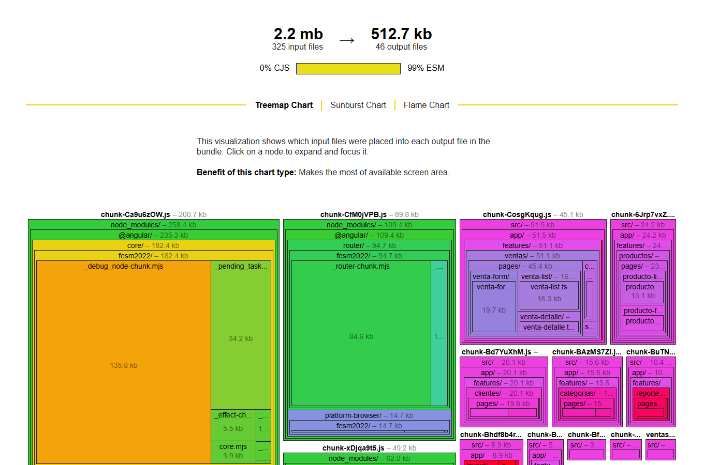

---

A. Comparación de precarga

Se comparó la configuración sin precarga con withPreloading(PreloadAllModules). Cinco contextos nuevos por variante; Chrome con caché deshabilitada, 1,5 Mbit/s de descarga, 750 kbit/s de subida y 80 ms de latencia. En ambas se espera 5 s en Inicio tras el login y luego se abre Ventas. Se midió hasta el encabezado y la carga del selector de clientes.

| Variante | Bytes de primera pantalla¹ | Clic a Ventas | Login a Ventas² |
| --- | --- | --- | --- |
| sin-precarga | 157040 B | 690.61 ms | 5994.24 ms |
| con-precarga | 207677 B | 201.14 ms | 5570.33 ms |

¹ Suma de encodedDataLength de Network.loadingFinished desde login hasta el fin de la espera en Inicio; incluye recursos, API y cabeceras de transporte de esa sesión. No es el Initial total del compilador. ² Incluye los 5 s de espera deliberada.

| Ensayo | Sin precarga: bytes / clic ms | Con precarga: bytes / clic ms |
| --- | --- | --- |
| 1 | 157041 / 588.93 | 207676 / 198.27 |
| 2 | 157041 / 591.83 | 207675 / 179.77 |
| 3 | 157040 / 558.53 | 207679 / 177.95 |
| 4 | 157039 / 859.98 | 207677 / 282.76 |
| 5 | 157038 / 853.76 | 207677 / 166.96 |

Decisión: mantener la carga bajo demanda. La precarga global añade 50637 bytes (32.2 %) a la primera pantalla y reduce la espera media del clic aproximadamente 489 ms. En tres locales con enlaces compartidos conviene evitar descargar módulos que el usuario puede no utilizar. La prioridad cambia si las mediciones reales de caja muestran que esos milisegundos dominan la operación; podría ensayarse precarga selectiva de Ventas.

Las cifras describen este entorno y una carga de ensayo pequeña; no prueban rendimiento de 3 locales concurrentes ni una mejora universal de latencia. La variante de precarga se retiró tras medir.

A-medicion.png · Exportación gráfica de los resultados guardados; no es una captura de DevTools.

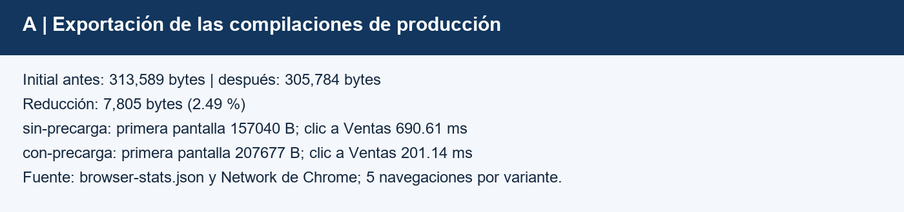

---

B. Políticas de caché del navegador

Nginx sirve la SPA en localhost:8081. Se verificaron los encabezados con curl -I y la recarga con Network del protocolo DevTools de Chrome. Un HTTP 200 de DevTools puede venir de memoria: se registran además requestServedFromCache y fromDiskCache.

| Recurso | Cache-Control obtenido | Origen de recarga | Correcto |
| --- | --- | --- | --- |
| /index.html | no-cache | Red / revalidación | Sí |
| /main-D676CMNU.js | public, max-age=31536000, immutable | Memoria | Sí |
| /chunk-CosgKqug.js | public, max-age=31536000, immutable | Memoria | Sí |
| /styles-AAJM6OEI.css | public, max-age=31536000, immutable | Memoria | Sí |
| /api/v1/categorias | no-cache, no-store, max-age=0, must-revalidate | Red | Sí |

La recarga de /ventas sirvió el documento con no-cache y los JS/CSS desde memoria; las llamadas del API fueron a red. La tabla usa el nombre real de cada archivo ensayado. index.html tiene la misma política del fallback de la SPA. No se observó 304 en esta recarga; no se lo presume a partir de no-cache.

Por qué el API no debe guardarse en el navegador

Los catálogos incluyen precio y stock y las respuestas pueden depender del usuario. Reutilizarlas tras ventas, cambios de permisos o cierre de sesión produciría datos obsoletos o exposición de datos. Spring Security añade por defecto Cache-Control: no-cache, no-store, max-age=0, must-revalidate, además de Pragma: no-cache y Expires: 0. No-store evita almacenar; no-cache por sí solo permite almacenar y exige revalidar.

La caché Redis es una capa del servidor: admite TTL e invalidaciones coordinadas y no reemplaza estas restricciones del navegador. Nginx no habilita proxy_cache para /api/.

B-cabeceras.png · Salida de encabezados obtenida con curl -I, exportada sin credenciales.

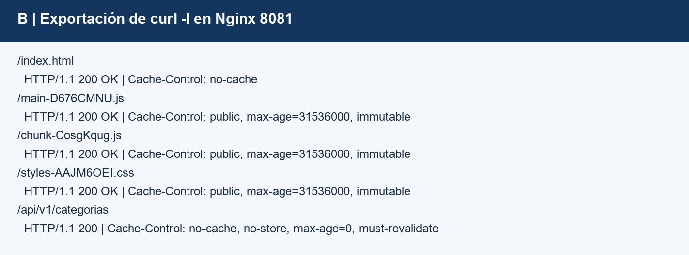

---

B. Simulación de despliegue

En el mismo contexto del navegador y con la caché conservada se abrió Productos, se cambió el título a «Productos - catálogo actualizado», se ejecutó otro build de producción y se recargó. Nginx continuó en ejecución y su volumen sirvió el directorio reconstruido.

| Observación | Obtenido |
| --- | --- |
| Texto visible nuevo | True |
| Se detuvo Nginx | No |
| Se borró la caché del navegador | No |
| JS/CSS con nombres nuevos | 12 |
| main antes / después | main-D676CMNU.js / main-HWAKLLAQ.js |
| CSS y runtime compartido | Conservaron hash cuando su contenido no cambió |

El texto cambió el chunk de Productos y propagó nuevos hashes a los archivos que lo referencian, incluido main. index.html revalidado apunta a esa nueva cadena. Los archivos nuevos van a red y los hashes conservados siguen reutilizables. Los nombres completos y los eventos de recarga están en B-despliegue.json. Que aparezcan varios hashes nuevos no significa que se haya descargado todo: la SPA solo solicita el grafo de la ruta visitada.

B-productos-antes.png · Recorte de la captura antes de reconstruir.

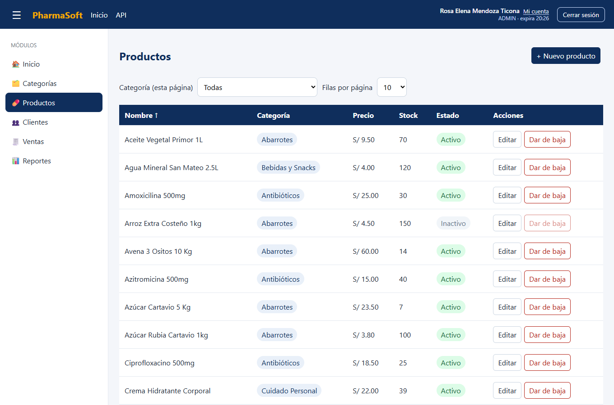

B-productos-despues.png · Recorte: mismo navegador y nuevo título.

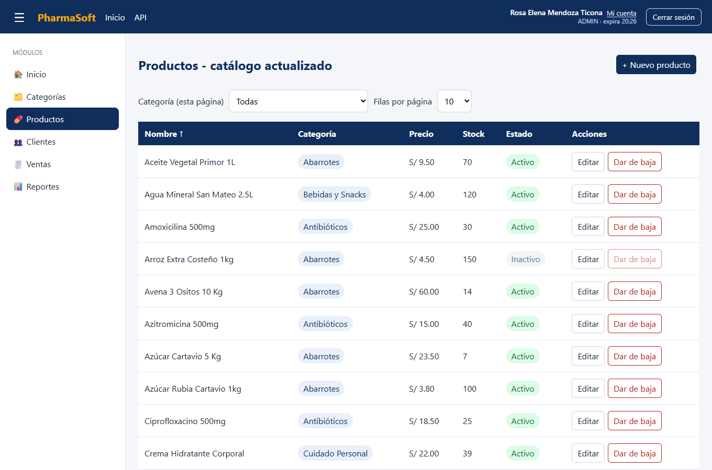

Riesgo del montaje de laboratorio: el build reemplaza dist mientras hay tráfico; una pestaña antigua podría pedir un chunk eliminado. En producción desplegar por releases atómicas, activar index al final y conservar hashes anteriores durante las sesiones abiertas.

---

C. Redis: aciertos y tiempos

Se inició la JVM con producción y Redis local. La primera lectura de cada clave fue un fallo; se hicieron 20 GET secuenciales por catálogo. El reinicio de la JVM no elimina Redis: hay que partir de la clave ausente y registrar deltas de métricas si existe otra actividad. Las capturas JSON conservan el estado previo y posterior de cache.gets.

| Caché | Fallos | Aciertos | Tasa | Primer GET | Media de 19 hit |
| --- | --- | --- | --- | --- | --- |
| categorias | 1 | 19 | 95 % | 499.175 ms | 29.214 ms |
| productos | 1 | 19 | 95 % | 83.694 ms | 28.172 ms |

Tasa = hit / (hit + miss) × 100 = 19 / 20 × 100 = 95 %. Los valores de cache.gets coinciden con 19 hits y 1 miss en cada caché. El ensayo filtró cache y result; también están disponibles las etiquetas name y cache.manager de esta instalación. Para repetición manual usar name:categorias o name:productos y result:hit/miss.

Los tiempos son de extremo a extremo del cliente Node hacia localhost:8080, incluyendo seguridad JWT, carga del usuario y transporte; no son tiempo puro de Oracle. Solo hay un primer fallo por caché: su «media» tiene n=1. No se presenta como un benchmark estadístico de fallos. Los 19 aciertos evitan la consulta del catálogo, aunque el filtro de seguridad todavía puede consultar el usuario.

TTL verificado y restaurado

| Configuración / paso | TTL obtenido | Hora UTC |
| --- | --- | --- |
| CACHE_TTL=1m; GET de clave nueva | 60 | 2026-11-09T00:58:22.453Z |
| Sin leer la clave durante la espera | -2 | 2026-11-09T01:02:25.748Z |
| CACHE_TTL=10m; clave repoblada | 600 | 2026-11-09T01:02:49.894Z |

Clave del ensayo: categorias::pagina-0-7-nombre-asc. redis-cli TTL devolvió 60; tras más de un minuto, -2 (inexistente); al restaurar y repoblar, 600. La variable cambia entradas nuevas, no las ya guardadas. El filtro final de C-05 añade el sufijo -activas-false/true a las claves paginadas para separar ambas consultas; el procedimiento de reproducción ya utiliza ese sufijo.

C-aciertos.png · Exportación gráfica de Actuator, tiempos y redis-cli.

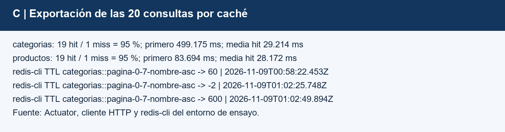

---

C. Matriz de invalidación ejecutada

| ID | Operación / esperado | Obtenido | Resultado |
| --- | --- | --- | --- |
| C-01 | Crear categoría: aparece | ID 127 presente en lista | Cumple |
| C-02 | Renombrar: producto muestra nombre nuevo | ZZ S13 mw8jow5i nueva | Cumple |
| C-03 | Precio nuevo en detalle y lista | 3,75 en ambas respuestas | Cumple |
| C-04 | Venta: stock descontado | Stock 10 → 9, venta 121 | Cumple |
| C-05 | Eliminar categoría vacía: ya no aparece | Ausente de activas; historial mantiene estado=false | Cumple tras corrección |
| C-06 | Redis apagado: funciona y health DOWN | Productos HTTP 200; health HTTP 503 DOWN | Cumple |

Se usaron registros exclusivos de ensayo; el cliente contiene datos sintéticos que no se exportan. La venta se conserva en el historial y no se borró. C-02 y C-04 calientan la lista antes de escribir para comprobar que se invalida una copia previa.

Revisión de las anotaciones

Categoría create/delete invalidan categorias; update invalida categorias y productos porque ProductoResponseDTO contiene categoriaNombre. Producto create/update/delete y Venta.registrar invalidan productos con allEntries=true. La caché envuelve la transacción para invalidar después del commit. No se encontró un defecto de anotación en los casos de ensayo.

Antes: C-05 devolvía HTTP 204 y estado=false, pero findAll conservaba la baja en el listado habitual. La invalidación funcionaba; el defecto era de la vista. Después: soloActivas=true filtra en Oracle antes de paginar y forma parte de la clave de caché. La SPA solicita activas por defecto y Mostrar inactivas conserva la consulta histórica. La API sin el parámetro mantiene su comportamiento anterior y los formularios pueden recuperar la categoría original. La nueva prueba calentó la lista activa, dio de baja otra categoría vacía y comprobó ausencia inmediata y presencia inactiva en historial.

C-04-stock.png · Recorte del producto de ensayo tras la venta desde la SPA.

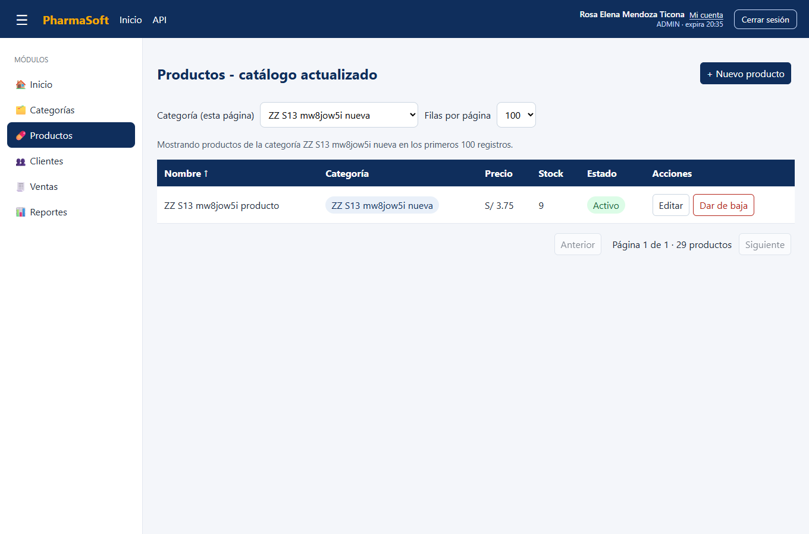

---

C. Evidencia de la corrección C-05

El filtro se ejecuta en el servidor antes de paginar: no se esconden filas únicamente en la página actual. Las dos variantes tienen claves distintas y las escrituras invalidan todo el catálogo, incluidas las páginas activas e históricas. La baja sigue siendo lógica y no se elimina información de auditoría.

C-05-activas.png · Vista habitual: la categoría dada de baja ya no aparece.

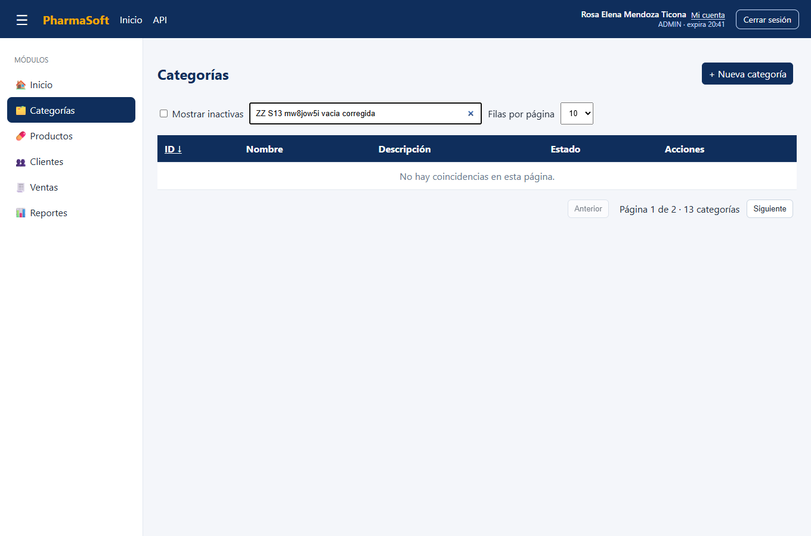

C-05-historico.png · Mostrar inactivas: la misma categoría permanece para consulta administrativa.

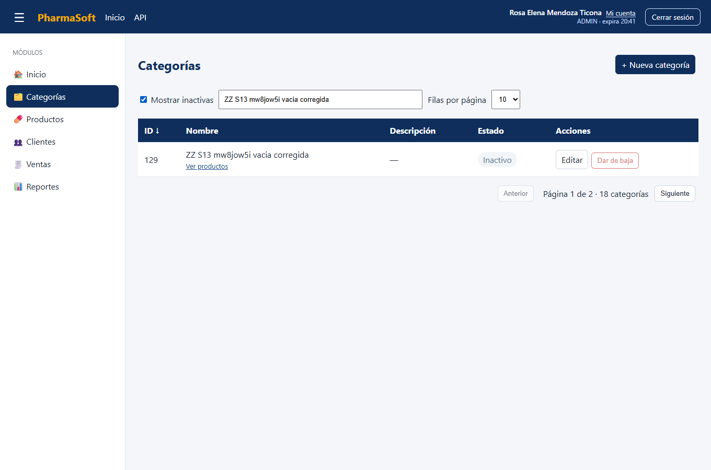

C-05-spa.json registra la ausencia por defecto y la presencia en historial; C-matriz.json conserva el resultado anterior y el resultado corregido. Una prueba del proxy real de Spring verifica que la baja invalida la lista activa y que su caché se separa de la administrativa. Dos pruebas de frontend verifican la solicitud paginada y la compatibilidad con el arreglo de la API antigua.

---

C. Redis apagado y riesgos restantes

Con Redis detenido: GET /productos devolvió HTTP 200. Health público devolvió HTTP 503 con status=DOWN; con administrador también fue DOWN y mostró Redis como componente fallido. Al restaurarlo, health volvió a HTTP 503 UP.

C-06-redis-detenido.png · Recorte: la SPA muestra el producto durante la caída.

Interpretación

El manejador de errores de caché permite seguir leyendo desde Oracle. Los límites de conexión y operación Redis son de 500 ms cada uno; una petición puede intentar lectura y escritura y sufrir más de un timeout. «Funciona» no equivale a la misma latencia. Los logs registran advertencias sin valores de caché ni credenciales.

Health global DOWN refleja una dependencia degradada; no significa que el proceso esté muerto. Liveness y readiness actuales no garantizan que cada dependencia crítica se evalúe como la operación de venta necesita. Configurar sondas y alertas con este criterio; no reiniciar indefinidamente la API por una caída de Redis.

Riesgos de consistencia que este ensayo no elimina

Si se escribe mientras Redis está caído, la invalidación puede perderse y reaparecer una clave antigua al reconectar. Además, una lectura concurrente iniciada antes del commit puede repoblar un valor viejo después de una invalidación. Un solo Redis compartido evita cachés aisladas por instancia, pero no elimina estas ventanas. Purgar selectivamente al recuperar y diseñar invalidación con versiones/eventos si se requiere consistencia fuerte. El TTL limita la vigencia, no la vuelve instantánea.

La venta descuenta stock con un UPDATE condicional en Oracle dentro de una transacción; no confía en el stock de Redis para autorizar la operación. Falta un ensayo de carga concurrente de los tres locales y de escrituras durante la caída antes de certificar producción.

---

D. Trazabilidad de una venta y errores

Se registró desde la SPA la venta 121 por S/ 3.75. Network entregó X-Request-Id: 317afa06. La búsqueda con rg de ese valor recuperó tres líneas del log de producción.

D-venta-log.png · Líneas reales filtradas por el identificador recibido por la SPA.

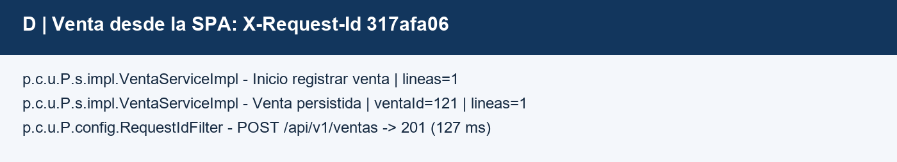

La primera línea indica que comenzó el registro y cuántas líneas tiene. La segunda identifica la venta persistida, sin cliente ni DNI. La tercera cierra la petición HTTP: POST /api/v1/ventas, estado 201 y 127 ms. El evento «persistida» ocurre dentro de la transacción; el acceso HTTP 201 es la evidencia de respuesta exitosa posterior. Un log interno aislado no prueba por sí solo que el commit terminó.

requestId en backend y frontend

RequestIdFilter genera ocho caracteres hexadecimales, los coloca en MDC y en X-Request-Id, y limpia el contexto al finalizar. GlobalExceptionHandler incorpora MDC.get("requestId") en ErrorResponseDTO; también se agregó en los errores de filtros 401/403. Se cubrieron errores de formato y fallos no controlados sin devolver detalles internos.

mensajeError de la SPA añade «Código de seguimiento: ...» desde error.error.requestId o, como alternativa, X-Request-Id. CORS ya expone esa cabecera. El usuario puede enviar solo ese código al soporte para localizar la petición sin compartir token, contraseña ni DNI. El código identifica una petición, no toda una sesión; ocho caracteres pueden colisionar, por lo que soporte debe combinarlo con fecha y ruta.

D-error-requestId.png · Recorte del error 404 real y su código de seguimiento.

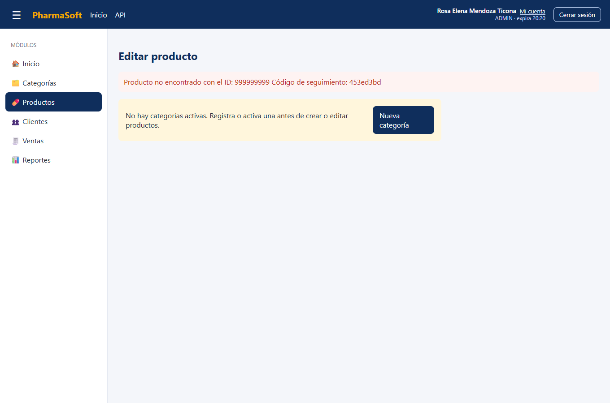

---

D. Auditoría y monitoreo

| Búsqueda | Histórico | Ejecución corregida |
| --- | --- | --- |
| palabras_password_bearer_secret | 0 | 0 |
| JWT_completo | 0 | 0 |
| DNI_explicito_completo | 0 | 0 |

Se revisó el archivo de producción y las líneas desde el arranque corregido. La búsqueda de palabras es orientativa: un nombre de clase puede dar falso positivo y un secreto sin etiqueta puede pasar inadvertido. Se añadieron patrones de JWT completos y DNI explícitos y se revisaron los lugares que escriben logs. Los tokens y claves reales usados durante la prueba nunca se exportaron.

Defecto corregido: ClienteServiceImpl.create registraba el DNI completo. Ahora registra «Inicio registrar cliente» y mantiene el ID interno de éxito. No se copian las coincidencias históricas al informe. Corregir el código no borra registros anteriores: restringir su acceso y aplicar la política de retención o redacción aprobada. La auditoría no demuestra que todo el equipo esté libre de secretos; cubre el archivo y los patrones indicados.

| Redis | Sin token | ADMIN con token |
| --- | --- | --- |
| Encendido | HTTP 200; UP; sin componentes | HTTP 200; UP; componentes db, redis, disco y sondas |
| Apagado | HTTP 503; DOWN; sin componentes | HTTP 503; DOWN; detalle del fallo Redis |

Métrica http.server.requests filtrada por uri:/api/v1/ventas: COUNT=1; TOTAL_TIME=0.1278275 s; MAX=0.1278275 s. Media=TOTAL_TIME/COUNT=127.828 ms. La muestra corresponde a un POST exitoso 201; no se registraron errores en esa serie. No describe /ventas/buscar ni ofrece p95, concurrencia o un SLA. Los valores se reinician con la JVM y el máximo depende de su ventana de registro.

D-health.png · Exportación de estados reales y conteos de auditoría sin datos sensibles.

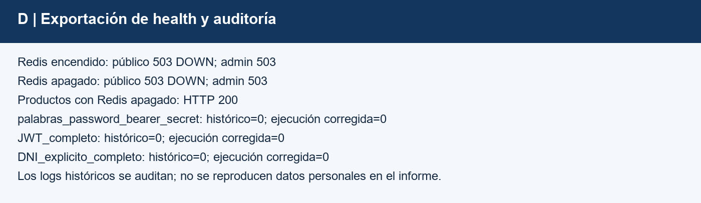

---

E. Arquitectura y configuración

Propuesta para tres locales: navegadores por HTTPS a un Nginx común; Nginx envía /api a PharmaBackend; Java consulta Oracle y Redis privados. Las tres sedes comparten datos y caché. La SPA no implementa ventas offline.

| Pieza | Laboratorio observado | Producción propuesta |
| --- | --- | --- |
| Navegadores de 3 locales | HTTP localhost:8081 | HTTPS 443 hacia Nginx |
| Nginx | Host 8081 → contenedor 80 | 443 público; 80 solo redirección |
| PharmaBackend | 8080 en anfitrión | 8080 privado tras proxy |
| Oracle | Host 1522 → contenedor 1521 | 1521 privado; no publicar a Internet |
| Redis | 127.0.0.1:6379 → 6379 | 6379 privado, autenticación/TLS si remoto |

Diagrama incluido en ambos README: Navegadores (locales 1, 2, 3) → Nginx:443 → PharmaBackend:8080 → Oracle:1521 y Redis:6379. Actuator se consulta internamente en 8080, con autorización para detalles y métricas.

| Variable / grupo | Propósito, sin valores reales |
| --- | --- |
| SPRING_PROFILES_ACTIVE | prod; evita configuración de desarrollo |
| DB_URL, DB_USERNAME, DB_PASSWORD | Conexión Oracle y cuenta de mínimo privilegio |
| JWT_SECRET | Base64 de 32 bytes aleatorios o más; igual en réplicas |
| JWT_EXPIRACION_MINUTOS | Duración de la sesión (30 min predeterminados en prod) |
| SERVER_PORT | Puerto privado de Java (8080 por defecto) |
| REDIS_HOST, REDIS_PORT | Redis compartido; 6379 por defecto |
| CACHE_TTL | 10m normal; 1m solo para el ensayo |
| SPRING_DATA_REDIS_PASSWORD / SSL_ENABLED | ACL y TLS para Redis remoto; prefijo completo SPRING_DATA_REDIS_ |
| FRONTEND_ORIGINS | Orígenes HTTPS autorizados por CORS |
| SPRING_FLYWAY_ENABLED | Controlar migraciones sobre un esquema preparado |

No hay secretos de backend en Angular. environment.ts contiene /api/v1 y se integra al build. El compose local fija puerto y alias backend:8080; dominio y TLS se definen en Nginx. Valores locales de desarrollo y cuentas de clase heredadas deben retirarse/rotarse antes de compartir la configuración de producción.

---

E. Despliegue, reversión y prioridades

Procedimiento verificable

1. Identificar releases por commit. Guardar JAR, frontend completo y configuración anterior. Respaldar Oracle y comprobar restauración antes de migrar.2. Backend: Java 21, mvnw clean verify y java -jar con perfil prod y variables seguras. El esquema local preexistente se ensayó con Flyway deshabilitado; V2 de seguridad sola no construye todo el esquema. Preparar migraciones iniciales y validar ddl-auto=validate.3. Frontend: npm ci y ng build --stats-json. Desplegar hashes primero y activar index.html al final, por directorios de release atómicos. Iniciar Nginx y Redis privados.4. Validar health público/ADMIN, login, catálogo, venta de ensayo, stock y requestId. Si falla, volver al release anterior y repetir los controles.5. Reversión: reactivar JAR y frontend anteriores compatibles. Purgar solo claves de catálogo del entorno si cambia la serialización. Restaurar Oracle o usar migración compensatoria cuando haya cambios incompatibles; cambiar el JAR no revierte datos.

| Práctica | Estado | Acción pendiente |
| --- | --- | --- |
| Lazy load, @defer y hashes | Cumple | Vigilar presupuestos |
| HTML revalidado y API no-store | Cumple | Conservar política en proxy |
| Redis TTL e invalidación | Parcial | Concurrencia y recuperación tras escrituras en caída |
| Logs, requestId y rotación | Cumple / histórico pendiente | Aplicar retención y acceso a históricos |
| Health y métricas restringidos | Cumple / alertas pendientes | Alertas externas y sondas por criticidad |
| Producción, migraciones y credenciales | Parcial | Completar V1; rotar y retirar cuentas de clase |
| HTTPS y backups restaurables | No en laboratorio | Implementar y ensayar antes del primer local |
| C-05 | Cumple tras corrección | Mantener filtro de activas e historial |
| Versionamiento | Pendiente | 3 fechas y PR reales |

Tres recomendaciones priorizadas

P1. HTTPS y red privada: publicar solo Nginx por 443, proteger administración con VPN/red privada y sustituir cuentas de clase por usuarios y secretos gestionados.P1. Oracle recuperable: copias cifradas fuera del servidor y simulacros. Proponer RPO de 1 hora y RTO de 4 horas para decisión de gerencia; son objetivos, no garantías medidas.P2. Redis compartido y alertas: una caché para las instancias de los tres locales, alertas de health/5xx/latencia y procedimiento selectivo de purga tras caída. Definir contingencia por pérdida de Internet; la aplicación actual requiere conexión.

---

F. Entrega, validación y evidencias

Validación ejecutada: frontend, 23 archivos y 53 pruebas aprobadas; backend, 42 pruebas aprobadas y JAR construido. Se excluyó PharmaBackendApplicationTests, que depende del contexto externo; esto no se presenta como una suite completa de contexto. Las comprobaciones HTTP y SPA de este informe sí usaron Oracle, Redis y Nginx reales.

| Entregable / criterio | Estado |
| --- | --- |
| Informe A a E y evidencias antes/después | Creado en docs/informe-s13.pdf y copia para aula virtual |
| Mejora adicional y medición inicial | Implementada y medida |
| Precarga, navegador y despliegue | Medidos; se conserva sin precarga |
| Matriz C-01 a C-06 | Ejecutada; C-05 corregido y repetido con evidencia |
| requestId en errores y SPA | Implementado, probado y capturado |
| README de ambos repositorios | Actualizados: arquitectura, variables, pasos, reversión y prioridades |
| Tres commits en días distintos por repositorio | Pendiente: no se alteraron fechas |
| Solicitud de incorporación a develop en ambos | Textos preparados; creación remota pendiente |
| Entrega al aula virtual | Archivo listo; subida pendiente del estudiante |

Archivos para repetir y sustentar

docs/s13/medir.mjs ejecuta los ensayos con credenciales en variables de entorno. docs/s13/reproducir.md explica condiciones y límites. docs/evidencias-s13 contiene metafiles, JSON de resultados y capturas con prefijos A, B, C y D. Las exportaciones gráficas de tablas están identificadas como tales; no se presentan como capturas de DevTools o Postman.

Las fechas de los tres commits no se pueden cumplir dentro de una sola sesión. Usar fechas reales, revisar los cambios locales previos antes de confirmar, publicar la rama y abrir PR hacia develop en ambos repositorios. No se afirmarían solicitudes creadas sin enlaces verificables.

Referencias y respaldo técnico

Angular: Deferred loading with @defer

esbuild: Bundle Size Analyzer

MDN: Cache-Control

Spring Data Redis: Redis Cache

Spring Boot: Metrics

Spring Security: Security HTTP Response Headers

Fuente académica: Actividad autónoma, sesión 13, documento de seis páginas facilitado por el estudiante. Los datos experimentales proceden del proyecto local; la documentación oficial respalda los conceptos, no sustituye las mediciones.
